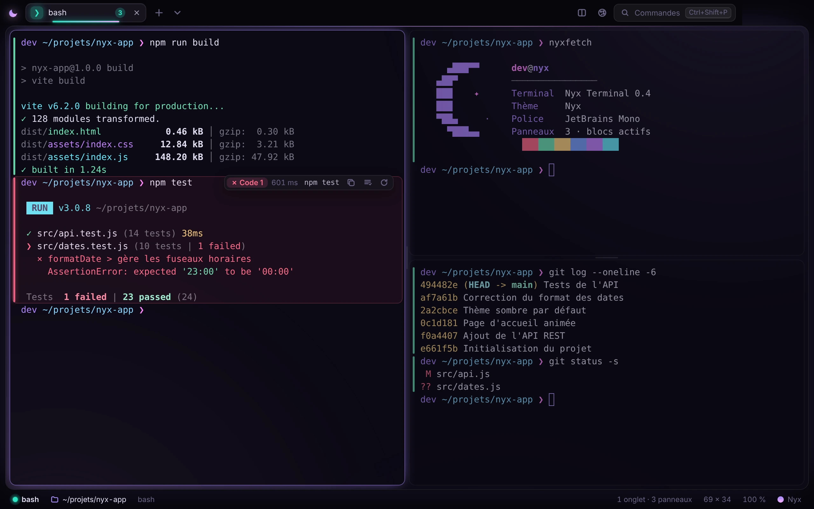
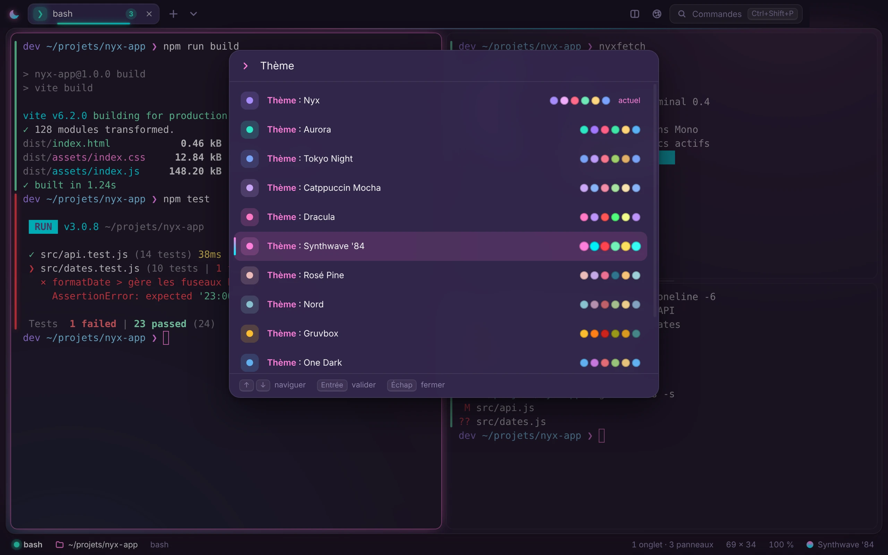
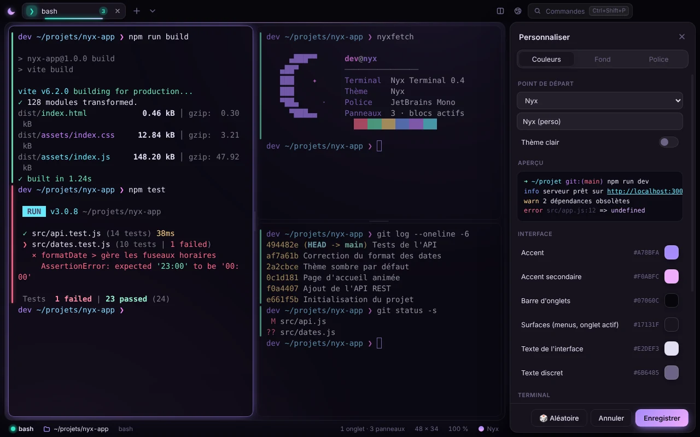
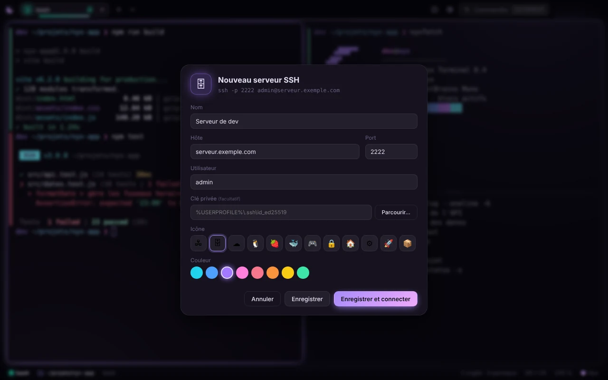
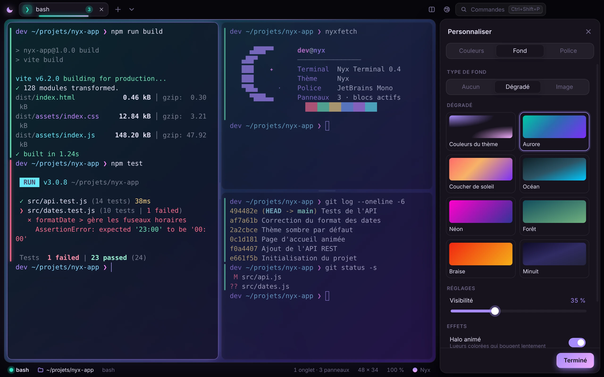

# Nyx Terminal

**Tous tes shells Windows dans une seule fenêtre.** PowerShell, CMD, WSL, Git Bash et tes serveurs SSH, côte à côte : divise l'écran, vois d'un coup d'œil quelle commande a réussi ou échoué, et règle chaque couleur à ton goût.

[Site officiel](https://ghostechos.github.io/nyx-terminal/) · [Vidéo de présentation](https://ghostechos.github.io/nyx-terminal/#video) · [Télécharger](../../releases/latest) · [Licence MIT](LICENSE)

[](https://ghostechos.github.io/nyx-terminal/#video)

Gratuit et open source, pour Windows 10 et 11 (64 bits).

## Télécharger

Dans **[Releases](../../releases/latest)**, prends :

- `NyxTerminal-Setup-x.y.z.exe` : l'installeur (raccourcis sur le Bureau et dans le menu Démarrer, désinstallation depuis les Paramètres Windows) ;
- `NyxTerminal-Portable-x.y.z.exe` : un seul fichier, sans installation.

**Vérifier un téléchargement** : compare son empreinte avec le fichier `SHA256SUMS.txt` de la version.

```powershell
Get-FileHash .\NyxTerminal-Setup-0.4.0.exe -Algorithm SHA256
```

> **« Windows a protégé votre ordinateur » ?** Les .exe ne sont pas encore signés numériquement, donc Windows ne connaît pas leur éditeur. Clique sur **Informations complémentaires**, puis **Exécuter quand même**. Ça ne veut pas dire que le fichier est dangereux.

## Fonctionnalités

**Pour travailler**

- **Blocs de commandes** : chaque commande et son résultat forment un bloc, avec une barre verte si elle réussit, rouge si elle échoue, animée pendant qu'elle tourne. Au survol : code de sortie, durée, copier la commande ou la sortie, relancer.
- **Onglets et panneaux divisés** : plusieurs terminaux côte à côte ou empilés dans un même onglet, redimensionnables à la souris (double-clic sur le séparateur pour revenir à 50/50), agrandissement temporaire d'un panneau.
- **Serveurs SSH** enregistrés avec une icône et une couleur, et import automatique de `~/.ssh/config`.
- **Mode Quake** : une touche globale (F12 par défaut) fait descendre un terminal depuis le haut de l'écran.
- **Dossier courant** dans la barre d'état (un clic l'ouvre dans l'Explorateur) ; les nouveaux onglets et panneaux s'ouvrent au même endroit.
- **Session restaurée** : onglets, panneaux, dossiers, taille et position de la fenêtre.
- **Notifications Windows** quand une commande de plus de 10 s se termine pendant que tu es ailleurs, plus un point vert ou rouge sur l'onglet.
- **Palette de commandes** (Ctrl+Shift+P) : toutes les actions au même endroit, avec recherche même sans accents.

**Pour l'apparence**

- **11 thèmes** (Nyx, Aurora, Tokyo Night, Catppuccin, Dracula, Synthwave '84, Rosé Pine, Nord, Gruvbox, One Dark…) et un **éditeur de thème** avec aperçu en direct, tirage de palette au hasard et thèmes perso enregistrés.
- **Fond d'écran** : ta propre image (flou et visibilité réglables) ou l'un des 8 dégradés.
- **Ligatures** (`=>`, `!=`, `->`…) avec Cascadia Code, Fira Code ou JetBrains Mono.
- Halo coloré animé, désactivable.

| Palette de commandes | Éditeur de thème |
|---|---|
|  |  |
| **Serveurs SSH** | **Fond d'écran** |
|  |  |

## Raccourcis

| Action | Raccourci |
|---|---|
| Palette de commandes | Ctrl+Shift+P |
| Personnaliser (thème, fond, police) | Ctrl+Shift+, |
| Nouvel onglet / avec le profil N | Ctrl+Shift+T / Ctrl+Shift+1…9 |
| Diviser automatiquement / à droite / en bas | Alt+Maj+D / Alt+Maj+= / Alt+Maj+- |
| Passer d'un panneau à l'autre | Alt+flèches |
| Redimensionner le panneau | Alt+Maj+flèches |
| Agrandir / restaurer le panneau | Alt+Maj+Z |
| Fermer le panneau (ou l'onglet) | Ctrl+Shift+W |
| Commande précédente / suivante | Ctrl+↑ / Ctrl+↓ |
| Onglet suivant / précédent / N | Ctrl+Tab / Ctrl+Shift+Tab / Alt+1…9 |
| Terminal Quake (global) | F12 |
| Copier / Coller | Ctrl+C (avec sélection) / Ctrl+V, clic droit |
| Rechercher | Ctrl+Shift+F |
| Zoom | Ctrl + / Ctrl − / Ctrl 0 / Ctrl+molette |

## Intégration shell

Les blocs de commandes, le dossier courant et les notifications fonctionnent automatiquement avec ces shells :

| Shell | Blocs | Code de sortie | Dossier |
|---|---|---|---|
| PowerShell 5 et 7 | ✓ | ✓ | ✓ |
| Git Bash | ✓ | ✓ | ✓ |
| WSL (bash) | ✓ | ✓ | ✓ |
| Invite de commandes | ✓ | — | ✓ |
| SSH (machine distante) | — | — | — |

Ton profil PowerShell (oh-my-posh, starship…) et ton `.bashrc` sont chargés normalement.

## Paramètres

Presque tout se règle depuis l'interface : thème, fond, police, raccourci du mode Quake, serveurs SSH, profils. Les réglages avancés sont dans `%APPDATA%\Nyx Terminal\settings.json` (Ctrl+,).

> La touche ² ne peut pas servir de raccourci global sous Windows : c'est pour ça que le mode Quake utilise F12 par défaut.

## Confidentialité

This program will not transfer any information to other networked systems unless specifically requested by the user or the person installing or operating it.

Nyx Terminal ne collecte aucune donnée et n'envoie rien sur Internet de lui-même : les seules connexions sont celles que tu lances depuis le terminal (ssh, git, npm…) et les liens que tu ouvres avec Ctrl+clic. Pour signaler une faille, voir [SECURITY.md](SECURITY.md).

## Feuille de route

- **v0.4** (disponible) : panneaux divisés, blocs de commandes, serveurs SSH, mode Quake, notifications, éditeur de thème, fonds d'écran, ligatures, session restaurée.
- **v0.5** (en préparation) : mises à jour automatiques, « Ouvrir dans Nyx Terminal » dans le clic droit de l'Explorateur, fenêtre de paramètres sans fichier JSON.
- **v0.6** (prévu) : signature du code, démarrage plus rapide, accès rapides dans la barre des tâches.
- **Plus tard** : partage de thèmes, historique des commandes amélioré, version macOS et Linux à l'étude.

Une idée ou un bug ? Ouvre une [issue](../../issues).

## Créateur et licence

Nyx Terminal est créé et maintenu par **PIYAS**, alias **Ghosty**.

[MIT](LICENSE) © 2026 PIYAS (alias Ghosty)
